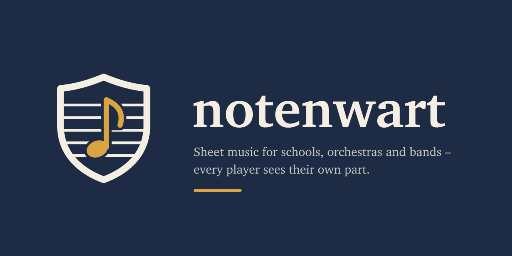

  

**Your sheet music, sorted and at hand.**

notenwart is a self-hosted sheet music library for music schools, orchestras, bands and choirs. Upload scores as
PDF, split them into parts, and give them to ensembles – every player sees exactly the parts they need, on phone,
tablet or music stand, online and offline.

- **Upload and split:** full scores, single parts or a scan with everything; pick the pages of each part, and
  notenwart recognises file names like `Trompete_2.pdf`. The parts are cut without re-encoding.
- **Only your part:** members see the parts for the instruments they play in their ensembles; leaders see
  everything, including the score.
- **Made for the stand:** a full-screen viewer with half-page turns, two pages side by side and Bluetooth
  page-turner pedals.
- **Offline:** keep an ensemble's parts on the device; when access ends, the copies go at the next sync.
- **Your server, your data:** one container with PostgreSQL and S3-compatible storage. No tracking, no telemetry.

| Repository | What |
|---|---|
| [notenwart](https://github.com/notenwart/notenwart) | server (Rust), web app and PWA (SvelteKit), API contract, brand |
| [website](https://github.com/notenwart/website) | the landing page at [notenwart.app](https://notenwart.app) |

> **Status:** in development – milestone 1 is complete; a first pilot with a music school in Brandenburg is being
> prepared.

notenwart is free software (AGPL-3.0-or-later; its API contract MIT) and a project of <a href="https://falkoss.org">falkOSS</a> – Falcon Lake Open Source Software gUG (haftungsbeschränkt) i. G., from Falkensee.
